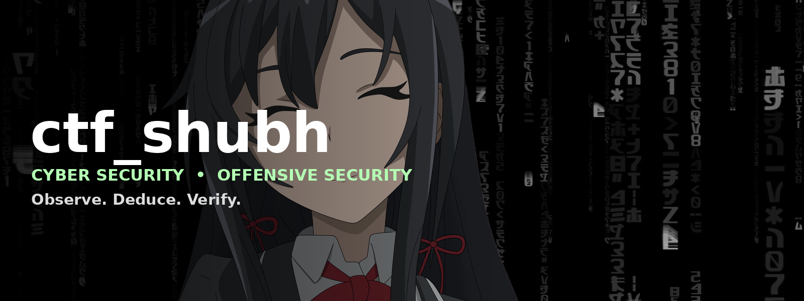
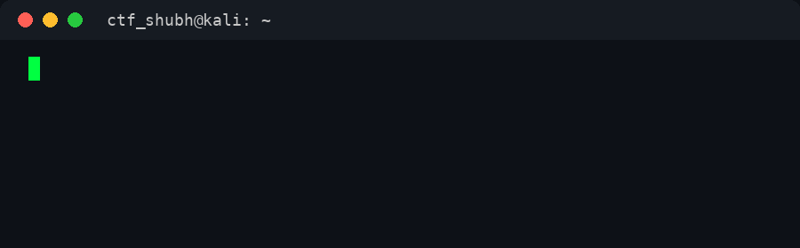

# ctf_shubh

---

## 🕵️ The Case File

- **Target:** Web Application Security — XSS, IDOR, SQLi, SSRF, CSRF, Business Logic
- **Method:** Recon → Map → Find → Prove → Report
- **Pentest flow:** Recon → Enumeration → Exploitation *(lab only)* → Reporting
- **Rule:** Evidence first. No proof, no report. Authorized labs only.

## 🛠️ Arsenal

## 📊 Evidence Board

**SHUBHAM.K** · Rank **0x8 Hacker** · Top 8% · Sapphire League · Path: AI Security · [tryhackme.com/p/SHUBHAM.K](https://tryhackme.com/p/SHUBHAM.K)

## 🏆 Trophies

## 🐍 Contribution Snake

<picture>
  <source media="(prefers-color-scheme: dark)" srcset="https://raw.githubusercontent.com/shubhamkowachi390-gif/shubhamkowachi390-gif/output/github-contribution-grid-snake-dark.svg">
  <source media="(prefers-color-scheme: light)" srcset="https://raw.githubusercontent.com/shubhamkowachi390-gif/shubhamkowachi390-gif/output/github-contribution-grid-snake.svg">
  
</picture>

## 🚀 Projects — Case Files

| Project | What it does | Stack |
|---|---|---|
| **AegisScope / NetReconX v2.0** | Attack-surface & recon suite, 0–100 score, subdomains, DNS/SPF/DMARC, IP/ASN, port latency | Rust + Tauri 2 *(private)* |
| **LeakForce — Lab Edition** | Lab-only sensitive-info + brute-force practice | Python, Rust, HTML, Java — [LeakForce](https://github.com/shubhamkowachi390-gif/LeakForce) |

> Both tools are for learning and authorized testing only.

## 🌱 The Investigation Continues

1. Networking — **done**
2. Web Fundamentals — **in progress**
3. OWASP Top 10 — **manual labs, next**
4. Tools — **after manual understanding**
5. Real practice, write-ups, then real-world security practice

---

<b>Every bug leaves evidence.</b> 
<i>Learning in public, one lab at a time.</i>

